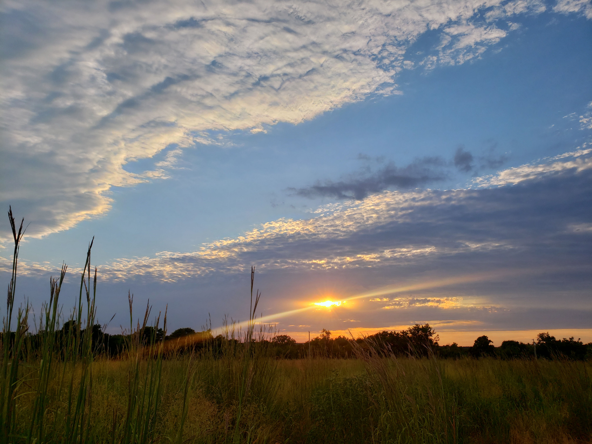
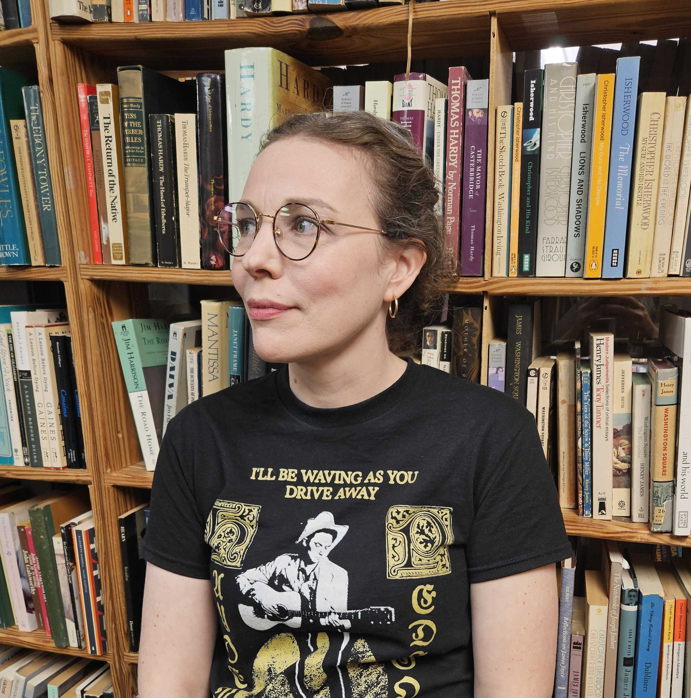
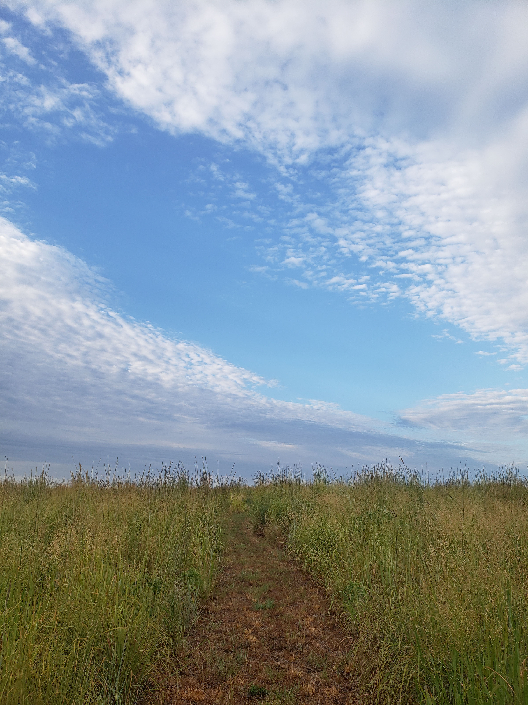

# Aleithia Stephens

writing toward a sense of place and time

---

## Writing: Selected Essays

**Tell** // *The Bulb Region* (forthcoming)

**Night Train** // *Glint Literary Journal* (forthcoming); first published in *Zest Literary Magazine* (2014)

**Superheroes by Daft Punk** // *Major 7th Magazine* (forthcoming)

[**Postscript**](https://paintedpebblelit.com/a-stephens-postscript/) // *Painted Pebble Lit Mag* (2026)

[**Muzak Serenade**](https://star82review.com/1.3/burgess-muzak.html) // *Star 82 Review* (2013)

**Lex Orandi, Lex Credendi** // in Robert Hendrickson's book, [*Yearning: Young Adults, Transformation, and the Church*](https://bookshop.org/p/books/yearning-authentic-transformation-young-adults-and-the-church-robert-hendrickson/d9e338ed2550db28?ean=9780819228680&next=t) (2013)

[**As American As Apple Pie**](files/as-american-as-apple-pie_2010.pdf) // *ExPat Lit* (2010)

*Note: Publications prior to 2016 are credited to Aleithia Burgess*

---

## Bio

Aleithia (Burgess) Stephens is a writer, educator, and choral musician. Her prose has appeared or is forthcoming in The Bulb Region, Glint Literary Journal, Painted Pebble Lit Mag, and elsewhere. She is at work on a collection of essays about sacred music, doubt, and forgiveness.

Wandering into an Evensong service at Westminster Abbey in 2009 kindled in Aleithia a longstanding fascination with the Anglican choral tradition, which she sees as embodying what T. S. Eliot called “the point of intersection of the timeless / With time.” In the years since, she has sung with choirs on both sides of the Atlantic, including St Andrew’s Cathedral (Aberdeen), Christ Church New Haven, and St. Paul’s Cathedral (Oklahoma City). She is also a member of the <a href="https://www.herberthowellssociety.com/">Herbert Howells Society</a>.

Aleithia holds bachelor’s degrees in History and Philosophy from Oklahoma State University and an MLitt in Renaissance and Early Modern Studies from the University of Aberdeen, where she also undertook doctoral research in Atlantic World history. She has worked full-time in higher education since 2013 and currently is part of Baylor University’s Learning Design team.

Originally from Tucson, Arizona, Aleithia has lived in Colorado, Oklahoma, Ohio, Connecticut, South Korea, and Scotland. After moving back to Oklahoma for the third time, she decided to call it home. She lives in Oklahoma City with her husband, son, and two tabby cats.

---

## Contact

Reach Aleithia via email: aleithia dot stephens at gmail dot com

Instagram: [@aleithias.words](https://www.instagram.com/aleithias.words/)

---

Copyright Aleithia Stephens, 2026
